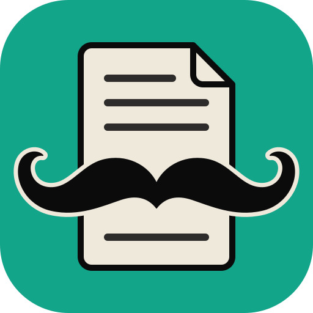

# PDFDOBIGODE app icon



**Motif:** *bigode* (Portuguese for moustache): a handlebar moustache with curled tips laid across a sheet
of paper with a folded corner and a few text lines.

**Style:** flat, bold shapes with an ink outline on a full-bleed colour field; no text, so it reads the same
in every language.

**Palette:** exactly three colours.

| Colour | Hex | Used for |
|---|---|---|
| Ink | `#0b0b0c` | the moustache, outlines and text lines |
| Paper | `#efe9dc` | the sheet and the halo around the moustache |
| PDFDOBIGODE green (app colour) | `#12a58a` | the full-bleed field |

**Tile:** `viewBox="0 0 512 512"`, a rounded square with `rx=112` that clips everything. Windows and Linux
icons use the full-bleed tile. macOS icons put it on Apple's grid (an 824 px body centred on a transparent
1024 px canvas).

**Provenance:** written by hand as SVG for PDFDOBIGODE (no tracing, no third-party material).
`pdfdobigode-small.svg` is a copy of the master, kept for the README. Licence:
[LICENSE.txt](LICENSE.txt) (`MIT OR Apache-2.0`, like the repo).

## Files

| File | What it is |
|---|---|
| `pdfdobigode.svg` | the master vector (hand-written SVG); every PNG, `.ico` and `.icns` is rendered from it |
| `pdfdobigode-small.svg` | a copy of the master for places that link it, such as this README |
| `pdfdobigode-1024.png` | 1024 px on Apple's grid; also the runtime Dock icon on macOS |
| `pdfdobigode.icns` | macOS icon (16–1024 px) |
| `pdfdobigode.ico` | Windows icon (16–256 px), embedded in `pdfdobigode.exe` by `apps/pdfdobigode/build.rs` |
| `pdfdobigode-document.svg` | Windows PDF file icon master: a Lucide document outline, green badge and outlined PDF lettering; no font dependency |
| `pdfdobigode-document.ico` | Windows PDF file icon (16–256 px), embedded as resource 2 in `pdfdobigode.exe` |
| `hicolor/<n>x<n>/apps/com.pdfdobigode.pdfdobigode.png` | Linux hicolor theme, 16–512 px; the 256 px one is the runtime icon on Windows and Linux |
| `hicolor/scalable/apps/com.pdfdobigode.pdfdobigode.svg` | Linux scalable icon (copy of the master) |

Where it shows: `apps/pdfdobigode/src/main.rs` sets the window icon (Dock, taskbar, Alt-Tab, launcher) and the
Wayland app id `com.pdfdobigode.pdfdobigode`; `packaging/linux/com.pdfdobigode.pdfdobigode.desktop` names the
hicolor icon.

Windows PDF files use resource 2 (`"pdfdobigode.exe",-2`) when PDFDOBIGODE is chosen as the default
reader; the app keeps resource 1. The document outline is adapted from Lucide `file-text`
1.49.0 (ISC); its badge and outlined lettering are original (`MIT OR Apache-2.0`), covered by
[LICENSE-document.txt](LICENSE-document.txt). Both icons are embedded, requiring no runtime
sidecar. This provides a file type icon; first-page thumbnails still need a thumbnail provider.

## Regenerate

```sh
packaging/icons.sh        # needs resvg and python3; iconutil (macOS) for the .icns
cargo xtask assets        # then update the sha256 values in ATTRIBUTION.toml and run with --write
```
